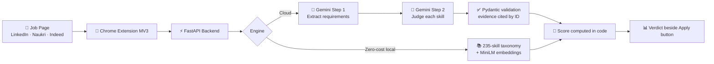
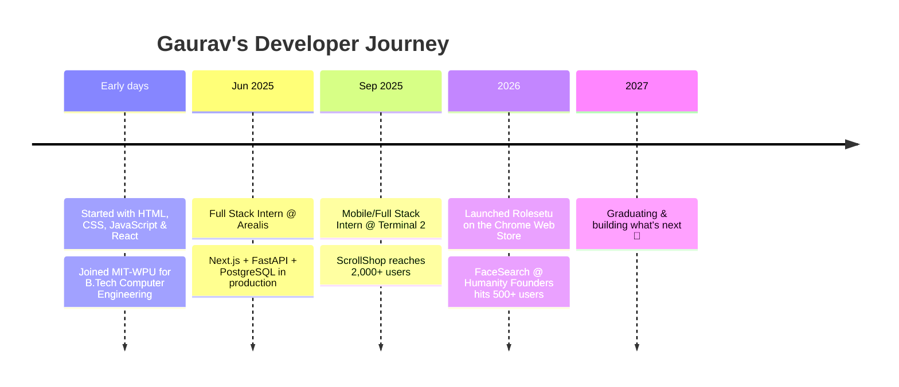

<!-- ===================== HEADER ===================== -->

  

  

  

  
  
  
  
  
  

  
  
  
  

---

## 🧑‍💻 About Me

I'm a **Full Stack & AI Engineer** with **1+ year of production experience** building web apps, REST APIs, and LLM-powered products end to end. I care about AI that's **grounded, testable, and safe**: structured outputs, cited evidence, and scores computed in code, not guessed by a model.

- 🚀 Building **[Rolesetu](https://github.com/gaurav-sunthwal/Rolesetu)**, an AI job-matching platform live on the Chrome Web Store
- 📱 Shipped production apps used by **2,000+** and **500+** users on Google Play & the App Store
- 🧠 Deep into **LLM pipelines, embeddings, prompt-injection defense & structured outputs**
- 🎓 B.Tech Computer Engineering @ **MIT World Peace University** (2027)
- 💬 Ask me about **Next.js, FastAPI, PostgreSQL/PostGIS, Gemini API, React Native**

> [!TIP]
> I'm **open to full-time roles & internships** in Full Stack / AI Engineering. Let's talk → [gauravsunthwalwork@gmail.com](mailto:gauravsunthwalwork@gmail.com)

---

## 🛠️ Tech Stack

  
   
  
   
  

  
  
  
  
  
  
  
  
  
  

<b>📂 Click to see the full skill breakdown</b>

 

| Category | Technologies |
|:--|:--|
| 🤖 **AI & LLMs** | Gemini API, structured outputs (Pydantic), prompt engineering, grounding, prompt-injection defense, embeddings (MiniLM), NLP |
| 💻 **Languages** | TypeScript, JavaScript (ES6+), Python, SQL, HTML5, CSS3, Java |
| 🎨 **Frontend** | React, Next.js, Redux Toolkit, Zustand, TanStack Query, Tailwind CSS, Chrome Extensions (MV3), Accessibility |
| ⚙️ **Backend** | FastAPI, Pydantic, Node.js, Express, REST APIs, WebSockets, zod, Spring, Stripe, Razorpay, RevenueCat |
| 🗄️ **Databases** | PostgreSQL, PostGIS, Neon, SQLAlchemy, Alembic, Drizzle ORM, DynamoDB, SQLite, Firebase |
| 🔐 **Auth & Security** | Firebase Auth, JWT, OAuth (Google, Apple), httpOnly sessions, CSRF protection, rate limiting |
| ☁️ **Cloud & Mobile** | AWS S3, Cloudflare R2, Railway, Vercel, CI/CD, Sentry, React Native, Expo, iOS, Android |
| 🧪 **Testing** | pytest, Vitest, Jest, React Testing Library, ESLint, code review, Agile/Scrum |

---

## 💼 Experience

<b>📱 Full Stack / Mobile App Developer Intern — Terminal 2</b> &nbsp;·&nbsp; <i>Sep 2025 – Present</i>

 

**ScrollShop**, a short-video commerce platform (Google Play · App Store)

- Build and maintain a production app used by **2,000+ users**, integrated with backend REST APIs
- Integrated **Stripe & Razorpay** payments and checkout flows
- Improved feed performance with optimized list rendering, a **multi-player video pool**, and offline caching
- Added push notifications, WhatsApp deep linking, and the Facebook SDK; handled builds, signing, and store releases

<b>🔎 Full Stack App Developer Intern — Humanity Founders</b> &nbsp;·&nbsp; <i>Jul 2026 – Sep 2026</i>

 

**FaceSearch**, a reverse image search app (Google Play · App Store)

- Owned the product **end to end**, from architecture to release; reached **500+ users in 2 months**
- Integrated Firebase Auth, REST APIs, email/push notifications, and **RevenueCat** subscriptions
- Set up CI/CD release pipelines and used **Sentry** for production monitoring and debugging

<b>🏦 Full Stack Developer Intern — Arealis</b> &nbsp;·&nbsp; <i>Jun 2025 – Aug 2025</i>

 

- Built production web apps with **Next.js, TypeScript & Tailwind** on a **FastAPI + PostgreSQL (Neon)** backend
- Built automation for handling **failed bank transactions**, across frontend and backend
- Implemented email automation with **Resend**; supported deployment and performance work

---

## 🚀 Featured Projects

  
  
   
  
  

### 🎯 Rolesetu — AI Job Matching Platform & Chrome Extension

  
  
  
  

Scores any job against your resume **skill by skill, with cited evidence**, right beside the Apply button on LinkedIn, Naukri, Indeed, and career sites.

<b>🔧 How the LLM client stays reliable</b>

 

- **Model fallback chain** and **API-key rotation**
- **Backoff retries**, timeouts, and **versioned prompts**
- **Prompt-injection guards** on scraped job content
- The model can't invent evidence or scores: verdicts cite evidence by ID, and the final score is computed in code
- Edits the user's own resume PDF in place

<b>📍 Phenko Mat — Location-Based Swipe Marketplace</b>

 

`Next.js` `TypeScript` `Node.js` `PostgreSQL + PostGIS` `Drizzle` `WebSockets` `Firebase Auth` `Zustand` `Cloudflare R2`

- Swipe marketplace for nearby free or low-cost items
- PostGIS feed with a **partial GiST index** and SQL ranking by distance, taste, and freshness
- Node.js **WebSocket chat gateway** with HMAC-signed tickets, read receipts, and backoff reconnect
- API secured with Firebase Auth, CSRF checks, and rate limiting

<b>🧑‍🎓 ScanMark — AI Face Recognition Attendance System</b>

 

`Next.js` `FastAPI` `TypeScript` `PostgreSQL` `AWS S3` `DynamoDB` `React Native`

- Next.js API + Python FastAPI face-recognition service + mobile client with **group recognition** and **offline mode**
- Storage split by workload: **S3** for photos, **DynamoDB** for face encodings, **PostgreSQL** for attendance
- JWT-secured REST API

<b>🎙️ FreeFlow — Private Voice Typing for Mac</b>

 

`Swift` `macOS`

- Hold a key, speak in any app, let go: clean, punctuated text appears at your cursor
- **No account, no subscription, no cloud.** Everything runs on-device

---

## 🗺️ My Journey

---

## 📊 GitHub Analytics

  <picture>
    <source media="(prefers-color-scheme: dark)" srcset="https://github-readme-stats.vercel.app/api?username=gaurav-sunthwal&show_icons=true&theme=tokyonight&hide_border=true&count_private=true&include_all_commits=true&bg_color=0f0c29&title_color=a78bfa&icon_color=a78bfa" />
    
  </picture>
  <picture>
    <source media="(prefers-color-scheme: dark)" srcset="https://github-readme-stats.vercel.app/api/top-langs/?username=gaurav-sunthwal&layout=compact&theme=tokyonight&hide_border=true&langs_count=8&bg_color=0f0c29&title_color=a78bfa" />
    
  </picture>

  <picture>
    <source media="(prefers-color-scheme: dark)" srcset="https://streak-stats.demolab.com?user=gaurav-sunthwal&theme=tokyonight&hide_border=true&background=0f0c29&ring=a78bfa&fire=a78bfa&currStreakLabel=a78bfa" />
    
  </picture>

  

<b>🏆 GitHub Trophies</b>

 

  

---

## 🟪 Contribution Overview

  

  
  
  

<b>🟩 Click to see my full contribution chart</b>

 

  

---

## ✍️ Random Dev Quote & Joke

  

<b>😂 Need a laugh? Click for a random dev joke</b>

 

  

---

  <b>Let's build something great together.</b> 
  <a href="mailto:gauravsunthwalwork@gmail.com">📫 gauravsunthwalwork@gmail.com</a> &nbsp;·&nbsp;
  <a href="https://gauravsunthwal.vercel.app">🌐 gauravsunthwal.vercel.app</a>

  

  

